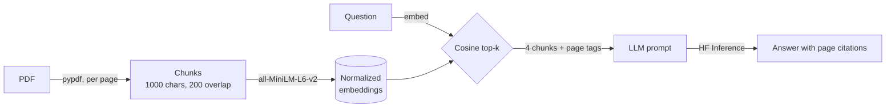

# 💬 LLM PDF Chat: retrieval-augmented QA over your documents

Upload a PDF and ask questions about it. The app finds the passages most
relevant to your question and has an LLM answer **only from those passages**,
citing the page numbers so you can check the answer.

Built with Streamlit, sentence-transformers and Hugging Face Inference. The
whole RAG pipeline is about 80 lines of plain Python ([`rag.py`](rag.py)) with
no orchestration framework, so every step is easy to inspect.

## How it works



1. **Extract.** `pypdf` reads text page by page, and every chunk keeps its page number.
2. **Chunk.** Text is split into windows of about 1,000 characters with a
   200-character overlap, so a sentence cut at a chunk boundary still appears
   whole in one of the two chunks.
3. **Embed.** `all-MiniLM-L6-v2` (384-dim) encodes each chunk. Vectors are
   L2-normalized, so a dot product equals cosine similarity.
4. **Retrieve.** The question is embedded and the 4 closest chunks are chosen.
   A single PDF has only hundreds of chunks, so exact search with numpy
   takes under a millisecond and no vector database is needed.
5. **Generate.** The chunks are inserted into a grounded prompt ("answer only
   from this context, cite pages, say you don't know otherwise") and sent to an
   instruction-tuned model through Hugging Face's `InferenceClient`.

The UI caches each document's index by **SHA-256 of the file contents**.
Re-uploading the same PDF is instant, and two different files that share a
name can never collide.

## Quickstart

```bash
git clone git@github.com:hsoni0303/LLM_Chat_PDF.git
cd LLM_Chat_PDF
python -m venv .venv && source .venv/bin/activate
pip install -r requirements.txt

cp .env.example .env    # add your Hugging Face token (free: hf.co/settings/tokens)
streamlit run app.py
```

You can pick any chat model available on Hugging Face Inference Providers by
setting `HF_MODEL` in `.env`. The default is `Qwen/Qwen2.5-7B-Instruct`.

## Project structure

```
├── rag.py            # chunking, embedding index, retrieval, grounded answer
├── app.py            # Streamlit chat UI (upload, chat history, source viewer)
├── tests/test_rag.py # chunking + prompt-construction tests (LLM is mocked)
└── requirements.txt
```

Run the tests with `pytest -q`.

## Design notes and limitations

- **Grounding over fluency.** The low temperature (0.2) and the
  "say you don't know" instruction cut down on hallucinations, and the
  **Sources** expander shows exactly which passages were used.
- **Scanned PDFs** have no text layer. The app detects this and shows an
  error; adding OCR (e.g. Tesseract) would be the next step.
- **Scaling up.** For many documents, replace the numpy search with FAISS or a
  vector DB, and add a re-ranker (e.g. a cross-encoder) on top of the
  first-stage retrieval.

## Changelog

- **v2:** Rewrote the app without LangChain. Migrated from the retired
  `HuggingFaceHub`/Flan-T5 endpoint to `InferenceClient` chat models. Added
  page citations, chat history and a source viewer. Replaced the on-disk
  pickle cache with an in-memory cache keyed by content hash. Added tests.
- **v1:** LangChain + FAISS + Flan-T5 prototype.
